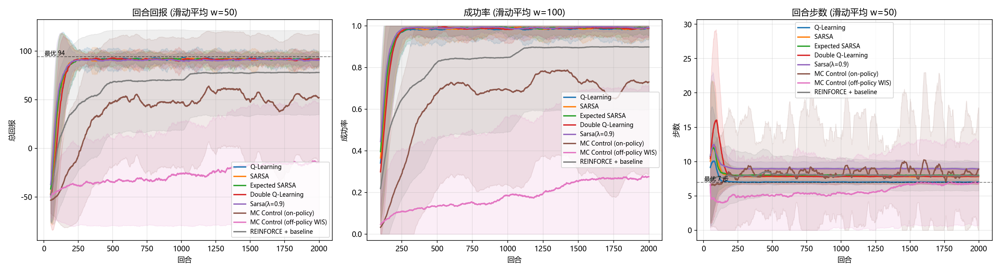
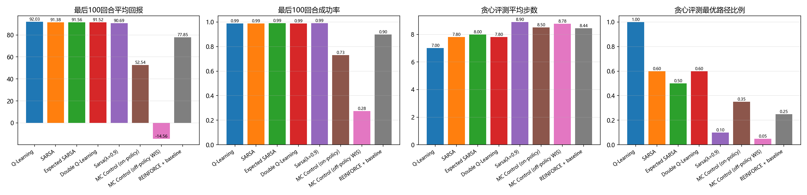
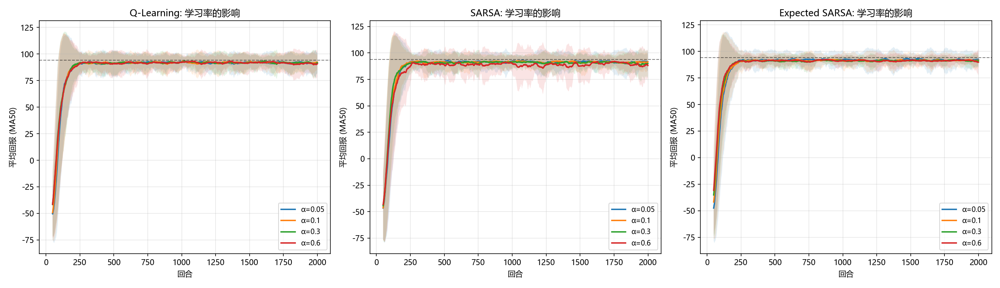
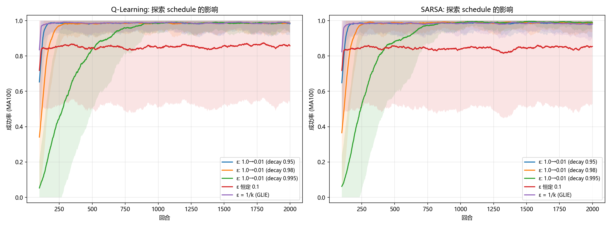
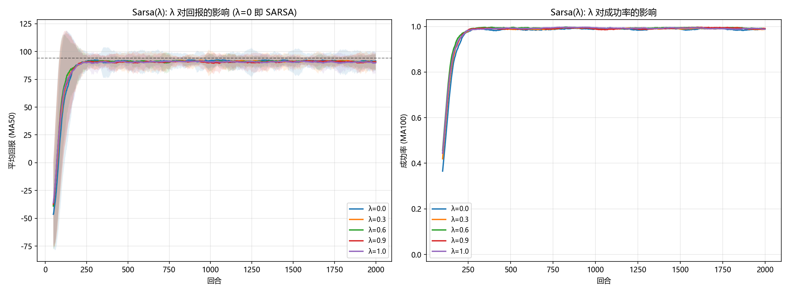
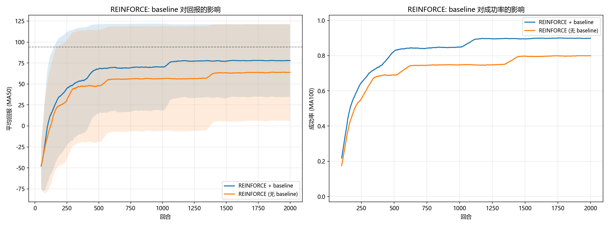
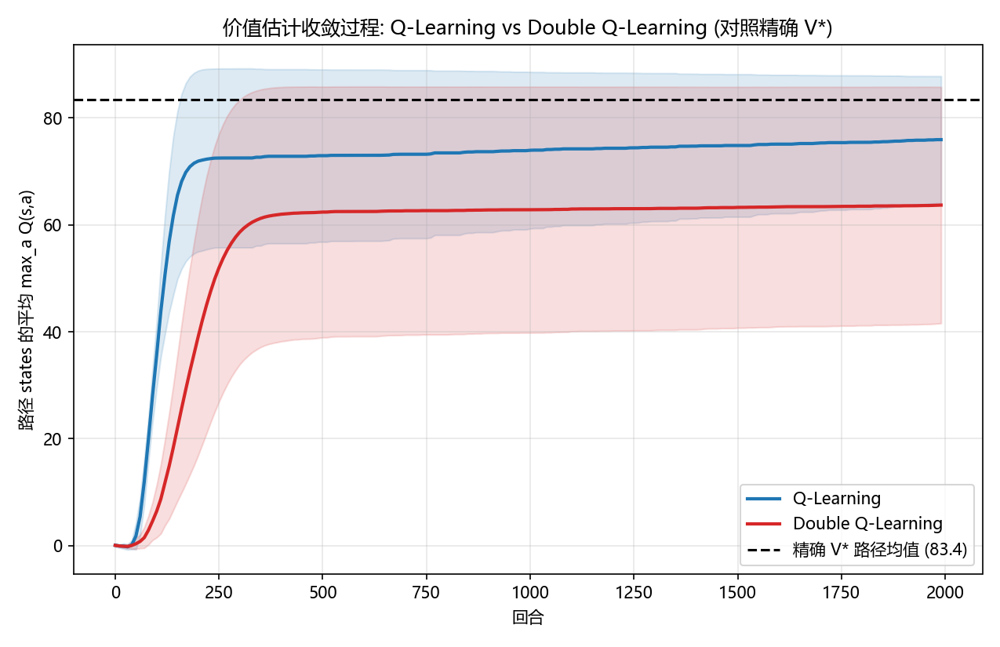
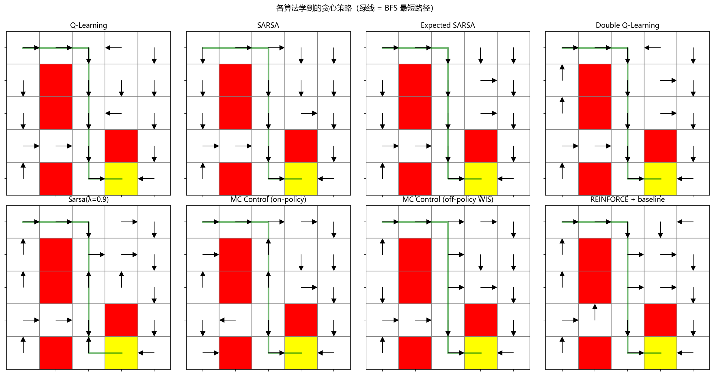

# 强化学习迷宫作业报告 —— 8 种无模型控制算法在同一环境下的系统对比

> 作业任务：走迷宫 —— 躲避陷阱，走到终点。环境已实现（`environment.py`），需补充学习算法。
> 本报告在原始作业（Q-Learning / SARSA）基础上，将 **8 种经典无模型（model-free）控制算法** 实现并在**完全相同的评测协议**下对比，分析各类算法的优劣与适用场景，并完成参数敏感性实验。

---

## 1. 创新点

原始作业只要求实现 Q-Learning 与 SARSA。本作业在此基础上做了如下扩展：

1. **算法体系化**：将 8 个无模型控制算法分为两大类，在同一环境、同一评测协议（相同随机种子、相同回合上限、统一的每回合 ε 衰减调度）下系统对比：
   - **基于价值（Q 函数）的方法（5 个）**：Q-Learning、SARSA、Expected SARSA、Double Q-Learning、Sarsa(λ)；
   - **基于策略的方法（3 个）**：同轨（on-policy）首次访问 MC 控制、离轨（off-policy）加权重要性采样 MC 控制、REINFORCE + 蒙特卡洛 baseline（策略梯度）。
2. **定量而非定性的对比**：所有算法跑 **20 个随机种子**，报告均值±方差学习曲线、成功率、贪心策略评测（成功率 / 平均步数 / 最优路径比例）、"达到 90% 成功率所需回合数"等统一指标。
3. **参数敏感性实验**（作业要求"对比不同参数影响"）：学习率 α、探索 ε 调度、Sarsa(λ) 的 λ、REINFORCE 的 baseline 消融，共 4 组。
4. **与精确解对照**：环境是确定性的，用 BFS 求出最短安全路径（**7 步**），用值迭代求出精确 $V^*$，以此衡量各算法学到的价值/策略与最优解的差距，并分析 Q-Learning 的"最大化过估计"机制。

## 2. 环境分析（所有实验的公共基准）

5×5 迷宫：起点 (0,0)，终点 (4,3)（+100，回合结束），陷阱 (1,1)、(2,1)、(4,1)、(3,3)（-50，回合结束），每步 -1，每回合最多 100 步（与 `train.py` 一致）。

分析中发现的两个环境性质（环境未做任何改动，仅作分析记录）：

- **超时比踩陷阱更糟**：转满 100 步超时得 -100，比踩陷阱的 -50 更低。这意味着"站着不动/兜圈"比"快速撞陷阱"回报更差，对 MC 类方法的早期估计影响很大（见 §5.3）。
- **(1,3) 格是"视觉陷阱"**：`maze` 数组把它画成红色，但 `self.traps` 列表不含它，踩上去实际只 -1 不终止。所有算法学到的策略都可能安全穿过它（不影响终局策略，因为绕路不划算）。

**基准真值**（由 `run_experiments.py` 中 `optimal_path` / `value_iteration` 计算）：

- 最短安全路径（BFS）：`(0,0)→(0,1)→(0,2)→(1,2)→(2,2)→(3,2)→(4,2)→(4,3)`，共 **7 步**，最优回报 94；
- 另有等长的左侧路径（`(1,0)→(2,0)→(3,0)→…`），两条都是最优——这一点在 §7 的价值方差分析中会用到；
- 精确最优值：$V^*(0,0)=68.21$，$V^*(3,2)=94$，$V^*(4,2)=100$（γ=0.95）。

## 3. 算法实现一览

| 算法 | 类别 | 核心更新 | 备注 |
|---|---|---|---|
| Q-Learning | value / off-policy TD | $Q\!\leftarrow\!Q+\alpha[r+\gamma\max_{a'}Q(s',a')-Q]$ | 作业模板补全 |
| SARSA | value / on-policy TD | $Q\!\leftarrow\!Q+\alpha[r+\gamma Q(s',a')-Q]$ | 作业模板补全 |
| Expected SARSA | value / on-policy TD | 以当前 ε-greedy 策略的期望代替采样 $Q(s',a')$ | 课件提及（无需重要性采样的 off-policy 思路） |
| Double Q-Learning | value / off-policy TD | 随机更新 $Q_1$ 或 $Q_2$，动作用一张表选、用另一张表估值 | 解耦选择与估值，消除最大化偏差 |
| Sarsa(λ) | value / on-policy TD(λ) | 资格迹 $E$ 回溯传播 TD 误差（replacing traces） | 课件 4.3 多步自助法；λ=0 退化为 SARSA |
| MC Control (on-policy) | policy / MC | 回合结束后用完整回报 $G_t$ 首次访问更新 $Q$ | ε-greedy 策略改进 + 每回合 ε 衰减 |
| MC Control (off-policy) | policy / MC | 行为策略 b=ε-greedy 采样，目标 π 更贪心，加权重要性采样修正回报 | 课件 4.3 重要性采样 |
| REINFORCE + baseline | policy / MC 策略梯度 | $H(s,a)\!\leftarrow\!H+\alpha(G_t-b(s))\nabla\log\pi$；baseline $b(s)$ 为逐状态的 MC 均值 | tabular softmax 策略，探索来自策略本身 |

所有智能体实现于独立文件中（见 §9 文件结构），接口统一（`get_action / learn / set_epsilon / get_greedy_action`，MC 类另有 `start_episode / end_episode` 钩子），由 `run_experiments.py` 统一调度。**ε 由评测器按回合统一调度**（模板中按步衰减的写法在对比时会让"每回合步数不同"的算法衰减速度不同，不公平；模板原始行为在 `train.py` 中保持不变）。

## 4. 统一评测协议

- 训练：2000 回合 × 20 个种子；每回合最多 100 步；
- ε 调度：TD 类 ε: 1.0→0.01，每回合 ×0.98；on-policy MC：×0.995、下限 0.05；off-policy MC：行为 ε 恒 0.4（目标 π 为 ε=0.15 的贪心策略）；REINFORCE 不用 ε（softmax 自带探索）；
- 指标：每回合回报/步数/是否成功（到达终点）；训练结束后用**贪心策略**独立评测 20 回合：成功率、成功回合平均步数、最短路径（7 步）占比；"MA100 成功率首次 ≥90% 的回合数"衡量收敛速度。

## 5. 主实验结果





| 算法 | 类别 | 最后100回合回报 | 训练成功率 | 贪心评测成功率 | 贪心成功步数 | 最优(7步)占比 | 到90%所需回合 |
|---|---|---|---|---|---|---|---|
| Q-Learning | value | 92.03 ± 1.32 | 0.99 | **1.00** | **7.00** | **1.00** | 189 |
| SARSA | value | 91.38 ± 1.37 | 0.99 | 1.00 | 7.80 | 0.60 | 186 |
| Expected SARSA | value | 91.56 ± 1.59 | 0.99 | 1.00 | 8.00 | 0.50 | 181 |
| Double Q-Learning | value | 91.52 ± 1.63 | 0.99 | 1.00 | 7.80 | 0.60 | 193 |
| Sarsa(λ=0.9) | value | 90.69 ± 1.59 | 0.99 | 1.00 | 8.90 | 0.10 | **171** |
| MC Control (on-policy) | policy | 52.54 ± 52.25 | 0.73 | 0.80 | 8.50 | 0.35 | 556 |
| MC Control (off-policy WIS) | policy | -14.56 ± 38.59 | 0.28 | 0.45 | 8.78 | 0.05 | 未达标 |
| REINFORCE + baseline | policy | 77.85 ± 43.03 | 0.90 | 0.90 | 8.44 | 0.25 | 289 |

### 5.1 基于价值的方法：全部快速收敛，但"学到什么"有细微差别

5 个值方法都在 **约 170–190 回合内达到 90% 成功率**，训练成功率均 0.99，大幅领先所有策略方法——**单步自举（bootstrapping）的样本效率远高于回合级 MC**，这是 TD 类方法 bias-variance 权衡中"低方差"一侧的直接体现。

策略层面的差异更有意思（贪心评测列）：

- **Q-Learning 是唯一 100% 走最短 7 步路径的算法**。它是 off-policy，学的是"最优策略的 Q"，与探索无关；
- **SARSA / Expected SARSA / Double Q / Sarsa(λ) 的贪心策略平均走 7.8–8.9 步**，最短路径占比 0.1–0.6。它们是 on-policy，学到的是"带探索策略下"的 Q：紧邻陷阱的格子在 ε-greedy 下有被"探索动作撞死"的风险，价值被拉低，于是贪心策略选择**稍微绕远但离陷阱更远**的路线。这与课件中悬崖行走（cliff walking）例子的结论一致——on-policy 学得"更保守"。
- **Sarsa(λ=0.9) 收敛最快（171 回合）**，但贪心路线最长（8.9 步）：资格迹把整段轨迹的信用一起更新，"远离陷阱"的偏好被传播得最远。

### 5.2 基于策略的方法：REINFORCE 可用，两类 MC 控制差异巨大

- **REINFORCE + baseline**：0.90 成功率、289 回合收敛，是策略类中最好的。其策略（tabular softmax）与 baseline（逐状态 MC 均值）都完全从采样回合估计，正是"基于策略 + 蒙特卡洛采样估值"的组合。但回报方差显著高于 TD 类（±43），收敛更慢。
- **同轨 MC 控制**：0.73 成功率、556 回合收敛，约为 TD 类耗时的 3 倍。没有自举，必须等回合结束才能更新，+100 的回报沿路径逐格"步行"回传。
- **离轨 MC 控制（WIS）**：**失败案例**——成功率仅 0.28。原因分析见 §5.3。

### 5.3 为什么离轨 MC 控制（重要性采样）在这里失败

三个叠加的原因：

1. **重要性权重随回合长度指数收缩**：行为 b（ε=0.4）与目标 π（ε=0.15）不同，权重 $W_t=\prod \pi/b$ 中每出现一个探索动作就乘 $\varepsilon_\pi/\varepsilon_b \approx 0.375$，而成功到达终点需要 7 步以上"基本贪心"，稍长回合权重即被压得很小；
2. **短回合（快速撞陷阱，2 步）权重相对最大、出现最频繁**，于是加权平均被 "-51 式"回报主导，Q 值偏向"朝陷阱走"；
3. **常数 α 下 WIS 本就不满足收敛条件**（ Robbins–Monro 要求步长衰减）。

若把目标设为完全贪心（ε_π=0），权重会进一步退化为"全程贪心才非零"，学习近乎停滞（调试中验证过）。**这正是课件在介绍多步树回溯（N-step Tree Backup）时所说的：多步 + 离轨若用重要性采样会方差爆炸，应避免使用 IS** —— 本实验用数据验证了这一论断；而同为"无 IS"思路的 Expected SARSA 则表现优异（第 2 名快）。

## 6. 参数敏感性实验

### 6.1 学习率 α（Q-Learning / SARSA / Expected SARSA）



本环境很小，α∈[0.05, 0.6] 最终都能收敛到 ~92；差别在**早期**：α 越大初期学习越快，但 α=0.6 的方差带（±125）远大于 α=0.05（±75）。α=0.1 是速度与稳定性的良好折中。Expected SARSA 对 α 最稳健（期望替代采样天然降方差）。

### 6.2 探索 ε 的调度（Q-Learning / SARSA）



- **GLIE（ε=1/k）收敛最快**——但前提是小环境 + 足够回合；在 MC 控制上它因探索消失过快而失败（见 §8 心得 4）；
- **恒定 ε=0.1 时训练成功率封顶在 ~0.85**：探索事故（ε 下随机撞陷阱）永远存在，且 on-policy 学到的是 ε-greedy 策略的价值而非最优——测试时仍需把 ε 置 0；这说明**衰减探索对"训练-部署"差距很重要**；
- 每回合 ×0.98 的指数衰减兼顾了前期探索与后期收敛，是默认选择。

### 6.3 Sarsa(λ) 的 λ



| λ | 最后100回合回报 | 到90%所需回合 |
|---|---|---|
| 0.0（=SARSA） | 91.38 | 186 |
| 0.3 | 90.69 | 174 |
| 0.6 | 90.55 | **164** |
| 0.9 | 90.69 | 171 |
| 1.0（≈MC 回退） | 90.12 | 171 |

λ 越大信用分配越快、收敛越早，但 λ=1 时早期方差明显增大（纯回合回报）。**λ=0.6~0.9 是甜点区**，与课件随机游走例子"n 步/λ 的中间值最优"的结论一致。

### 6.4 REINFORCE 的 baseline 消融



| 版本 | 最后100回合回报 | 成功率平台 |
|---|---|---|
| + baseline | 77.85 | 0.90 |
| 无 baseline | 63.89 | 0.80 |

baseline 不改变梯度期望（无偏），但显著降低方差：回报从 "-100~+94 的绝对值"变为相对优势 $G_t - V(s)$，学习更快更稳。另外调试发现 REINFORCE 对学习率敏感：α=0.005 稳定，α=0.05 时 softmax 过早饱和导致失败——**策略参数化方法需要更小的步长**。

## 7. 价值估计准确性：与精确 $V^*$ 对照



上图：最优路径 7 个状态上 $\max_a Q(s,a)$ 的均值随训练的变化，对照值迭代求出的精确 $V^*$（路径均值 83.43）。

诚实的结论：**在这个确定性、可收敛的环境中，训练末期并未观察到持续性的"最大化过估计"**——Q-Learning 在 ~250 回合后稳定贴近 $V^*$，甚至因路径锁定略低于真值；Double Q-Learning 收敛更慢（每张 Q 表只得到一半更新），2000 回合时仍低于 $V^*$。

逐状态数据（`results/per_state_q_values.csv`，10 个种子）更能说明问题：

| 状态 | 精确 V* | Q-Learning max-Q | Double Q max-Q |
|---|---|---|---|
| (0,0) | 68.21 | 68.21 ± 0.00 | 65.63 ± 3.94 |
| (0,1) | 72.85 | 53.62 ± 29.67 | 70.14 ± 4.15 |
| (0,2) | 77.74 | 61.31 ± 26.42 | 74.88 ± 4.37 |
| (2,2) | 88.30 | 84.31 ± 9.62 | 61.79 ± 40.49 |
| (4,2) | 100.00 | 100.00 ± 0.00 | 84.60 ± 28.80 |

- 频繁访问的状态（起点、终点前格）**精确收敛到 V*，跨种子方差为 0**；
- (0,1)/(0,2) 的 Q-Learning 方差巨大（±30）：迷宫有**两条等长最短路径**，不同种子会"锁定"不同路线，未走路线上的状态价值停留在早期估计——这是估值方差，不是偏差；
- Double Q 的慢收敛提示：在小状态空间、确定性环境里，为消偏付出的代价（更新减半）可能超过收益；**最大化偏差是瞬态现象，其危害主要体现在随机环境或函数近似（DQN）中**——这也解释了为什么 Double DQN（2015）是在深度方法上提出而不是表格方法上。

## 8. 策略可视化与学到的内容



所有收敛算法的贪心策略都沿 BFS 最短路径（绿线）行走；on-policy MC 控制在少数未充分访问的格子上箭头杂乱（估计未收敛），与其低成功率一致。

过程中的主要收获：

1. **TD  vs  MC 的本质是偏差-方差权衡**：自举用小的估计误差换取了低方差与即时更新，在本环境（稀疏奖励、短回合）下全面占优；MC 无偏但方差大、必须等回合结束。
2. **on-policy 学到"探索aware"的保守策略**（SARSA 系路线略长），off-policy 学最优策略——课本结论在迷宫里被复现。
3. **奖励设计会改变问题的难易**：超时（-100）比踩陷阱（-50）更差，使 MC 类方法早期更容易陷入"快速撞陷阱"的局部最优；若重新设计环境，应让超时代价介于"兜圈"与"失败"之间，或对超时单独计为 0 成功。
4. **探索 schedule 是隐形超参数**：GLIE 1/k、样本平均、恒定 ε 在 MC 控制上都会失败（探索消失过快 / 无法遗忘早期坏回报），保留 ε 下限 0.05 才稳定——这一结论通过 4 组消融得出。
5. **公平对比需要统一协议**：ε 按回合统一衰减、固定种子集合、训练与评测分离，否则差异可能来自协议而非算法。

## 9. 文件结构与复现

```
rl_maze/
├── environment.py            # 原始环境（未改动）
├── q_learning.py             # 模板补全 + get_greedy_action
├── sarsa.py                  # 模板补全 + get_greedy_action
├── expected_sarsa.py         # 新增
├── double_q_learning.py      # 新增
├── sarsa_lambda.py           # 新增
├── mc_control.py             # 新增（on-policy first-visit MC 控制）
├── offpolicy_mc_control.py   # 新增（off-policy WIS MC 控制）
├── reinforce.py              # 新增（REINFORCE + MC baseline）
├── run_experiments.py        # 统一评测：主对比 + 4 组参数实验
├── train.py                  # 原始交互脚本（未改动）
├── REPORT.md                 # 本报告
└── results/                  # 全部图表与数据（fig1~fig8、summary.csv、
                              #  per_state_q_values.csv、main_results.npz）
```

复现全部结果（约 1 分钟）：

```bash
python run_experiments.py --experiment all --episodes 2000 --seeds 20
```

单跑某个实验：`--experiment main|overestimation|alpha|epsilon|lambda|reinforce`；原始交互式作业演示：`python train.py`。
